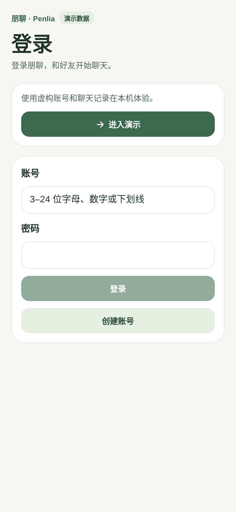
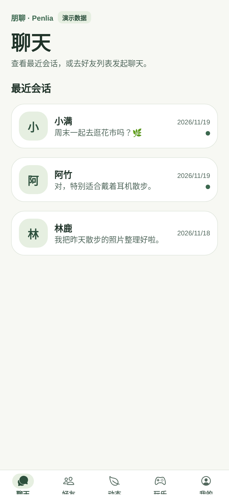
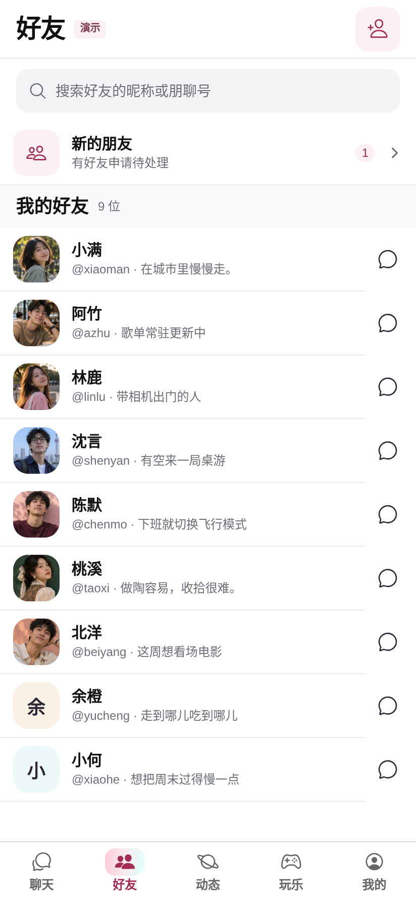
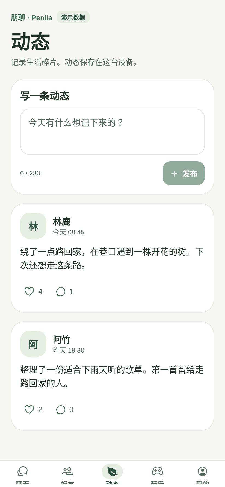
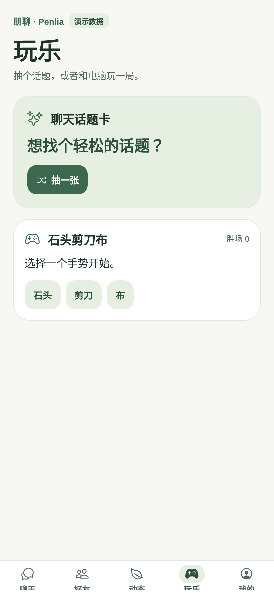
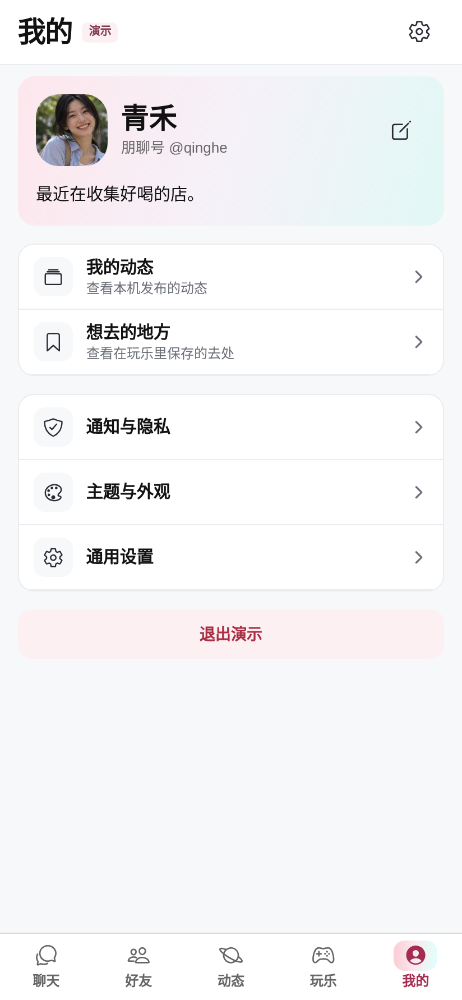
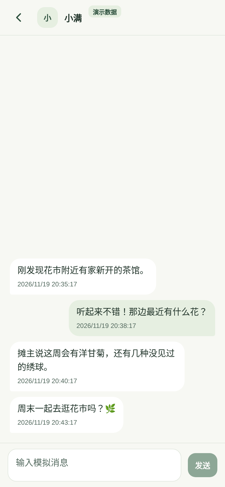

# 朋聊演示

七张截图来自在 412 × 891 手机视口中实际运行的 Expo 网页版。演示版使用与正式 App 相同的页面和导航，Android 的系统字体、键盘和状态栏可能与截图不同。

| 页面 | 页面 |
| --- | --- |
| [登录](screenshots/01-login.png) | [聊天](screenshots/02-chats.png) |
|  |  |
| [好友](screenshots/03-friends.png) | [动态](screenshots/04-moments.png) |
|  |  |
| [玩乐](screenshots/05-play.png) | [我的](screenshots/06-profile.png) |
|  |  |
| [聊天详情](screenshots/07-conversation.png) | |
|  | |

打开「朋聊演示」，点「进入演示」。可以进入「小满」的会话发送模拟消息，在好友页查找 `zhouzhou` 或处理申请，也可以发动态、玩小游戏和编辑自己的资料。

演示账号、好友和消息在应用重启后恢复初始状态。演示动态保存在这台设备。全部演示操作在本机处理。

演示构建使用 `ui-demo` 配置和 `app.penlia.mobile.preview` 包名，可以与正式 App 同时安装。

## 在 Android 手机上安装

1. 在手机浏览器登录有仓库权限的 GitHub 账号，打开 APK 文件页，点「Download raw file」下载。[打开 APK 文件页](Penlia-UI-Demo-arm64.apk)
2. 在手机的「文件管理」中打开「下载」，点 `Penlia-UI-Demo-arm64.apk` 安装。如系统询问，请按提示允许当前浏览器或文件管理器安装应用。
3. 打开「朋聊演示」，点「进入演示」。安装和体验均无需 Expo 账号。

安装包约 40 MiB，适用于 Android 7.0 及以上的 ARM64 设备。APK 由本地 Gradle 原生编译，使用测试签名并通过签名校验。七个页面和离线交互已在浏览器验证，Android 真机体验待验证。

APK 的 SHA-256 为 `e18594187c230be8076d186021d48b78dbf2d32130ea9bba3aa8dd3fb4ebacff`。
